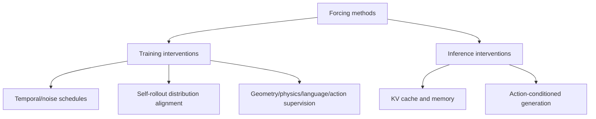

# Awesome Forcing for Embodied AI

A curated **mechanism-first** paper list of Forcing methods in embodied AI, robotic world/action models, and adjacent video generation.

**33 indexed entries · primary-source review in progress · execution verification pending.**

[Browse paper index](data/papers.csv) · [Code, checkpoints & evaluation](data/release-audit.csv) · [Contribute](CONTRIBUTING.md)

## Taxonomy

The term **Forcing** is used for different interventions, not a single unified technique.

## Papers by forcing mechanism

All **33 entries** are shown below. **Reviewed** means source-level bibliographic review, not experimentally reproduced; **candidate / secondary-listed / pending** entries remain provisional. Links are only provided when present in the index or release audit.

### Rollout & exposure bias

| Year | Paper / method | Main intervention | Paper | Code / project | Evidence |
|---|---|---|---|---|---|
| 2026 | AR Forcing | Autoregressive training with model-generated navigation context | [Paper](https://arxiv.org/abs/2605.31314) | — | Reviewed |
| 2026 | Causal Forcing | Autoregressive teacher for ODE initialization in causal distillation | [Paper](https://arxiv.org/abs/2602.02214) | [Source](https://github.com/thu-ml/Causal-Forcing) | Reviewed |
| 2026 | Causal Forcing++ | Mechanism not yet verified | — | [Source](https://github.com/thu-ml/Causal-Forcing) | Secondary only |
| 2026 | Fréchet Forcing | Long rollout distribution matching | [Paper](https://arxiv.org/abs/2610.25666) | [Source](https://github.com/Zhao-Yian/Frechet_Forcing) | Reviewed |
| 2026 | Self-Aligned Forcing | Differentiable denoising-stage-aligned noisy histories | [Paper](https://arxiv.org/abs/2609.38114) | — | Reviewed |
| 2026 | Step Forcing (RoboWorld) | Anchored and one-step self-forwarded robot rollout contexts | [Paper](https://arxiv.org/abs/2607.01060) | [Source](https://byeongguks.github.io/RoboWorld/) | Reviewed |
| 2025 | Self Forcing | Self-generated autoregressive history reduces exposure bias | [Paper](https://arxiv.org/abs/2506.08009) | [Source](https://github.com/guandeh17/Self-Forcing) | Reviewed |
| 2025 | Self-Forcing++ | Teacher-guided distillation on self-generated long-rollout segments | [Paper](https://arxiv.org/abs/2510.02283) | [Source](https://github.com/justincui03/Self-Forcing-Plus-Plus) | Reviewed |

### Temporal & diffusion noise

| Year | Paper / method | Main intervention | Paper | Code / project | Evidence |
|---|---|---|---|---|---|
| 2026 | Steady-Forcing | Mechanism not yet verified | — | [Source](https://github.com/minar09/steady-forcing) | Secondary only |
| 2025 | Rolling Forcing | Joint rolling-window denoising with progressive noise and attention sink | [Paper](https://arxiv.org/abs/2509.25161) | [Source](https://github.com/TencentARC/RollingForcing) | Reviewed |
| 2024 | Diffusion Forcing | Per-token diffusion noise levels | [Paper](https://arxiv.org/abs/2407.01392) | [Source](https://boyuan.space/diffusion-forcing) | Reviewed |

### Physics

| Year | Paper / method | Main intervention | Paper | Code / project | Evidence |
|---|---|---|---|---|---|
| 2026 | PhysisForcing | Physical and structural consistency | [Paper](https://arxiv.org/abs/2606.28128) | [Source](https://github.com/DAGroup-PKU/PhysisForcing) | Reviewed |

### Geometry & representation

| Year | Paper / method | Main intervention | Paper | Code / project | Evidence |
|---|---|---|---|---|---|
| 2026 | Relational Geometry Forcing | Pairwise geometry relations from frozen 3D foundation model | [Paper](https://arxiv.org/abs/2610.29282) | — | Reviewed |
| 2025 | Geometry Forcing | Mechanism not yet verified | — | [Source](https://github.com/CIntellifusion/GeometryForcing) | Secondary only |

### Language

| Year | Paper / method | Main intervention | Paper | Code / project | Evidence |
|---|---|---|---|---|---|
| 2026 | Language-Forcing | Language-aligned world/action representations | [Paper](https://arxiv.org/abs/2610.23894) | — | Pending |

### Action conditioning

| Year | Paper / method | Main intervention | Paper | Code / project | Evidence |
|---|---|---|---|---|---|
| 2026 | Action Forcing | Recover egomotion control axes from unlabeled videos | [Paper](https://arxiv.org/abs/2609.30595) | — | Reviewed |
| 2026 | Delta Forcing | Mechanism not yet verified | — | [Source](https://github.com/wyhallenwu/DeltaForcing) | Secondary only |
| 2026 | WorldSync (Action-Forcing) | Action-forcing expert and intervention-effect alignment | [Paper](https://arxiv.org/abs/2608.24885) | — | Reviewed |

### Action representation

| Year | Paper / method | Main intervention | Paper | Code / project | Evidence |
|---|---|---|---|---|---|
| 2026 | Discrete Forcing | Discrete guidance for continuous action | [Paper](https://arxiv.org/abs/2609.39526) | [Source](https://github.com/XPolicyLab/XPolicyLab/blob/main/policy/Discrete_Forcing/README.md) | Pending |

### Future prediction

| Year | Paper / method | Main intervention | Paper | Code / project | Evidence |
|---|---|---|---|---|---|
| 2026 | Next Forcing | Multi-chunk future prediction | [Paper](https://arxiv.org/abs/2606.11187) | [Source](https://github.com/robbyant-research/next-forcing) | Reviewed |

### Reward

| Year | Paper / method | Main intervention | Paper | Code / project | Evidence |
|---|---|---|---|---|---|
| 2025 | Reward Forcing | EMA-sink and reward-weighted distribution matching distillation | [Paper](https://arxiv.org/abs/2512.04678) | [Source](https://github.com/JaydenLyh/Reward-Forcing) | Reviewed |

### Memory

| Year | Paper / method | Main intervention | Paper | Code / project | Evidence |
|---|---|---|---|---|---|
| 2026 | Neighbor Forcing (SoulX-LiveAct) | Mechanism not yet verified | — | [Source](https://github.com/Soul-AILab/SoulX-LiveAct) | Secondary only |
| 2026 | RECAP-Forcing | Novelty-based appearance-indexed KV memory | [Paper](https://arxiv.org/abs/2608.26671) | [Source](https://github.com/xXuHaiyang/RECAP-Forcing) | Reviewed |
| 2026 | Recency Forcing | Time-step dependent temporal response bias for KV eviction alignment | [Paper](https://arxiv.org/abs/2609.19729) | — | Reviewed |
| 2025 | Memory Forcing | Minecraft geometry-indexed spatial memory and chained forward training | [Paper](https://arxiv.org/abs/2510.03198) | [Source](https://junchao-cs.github.io/MemoryForcing-demo/) | Reviewed |
| 2025 | Pack and Force Your Memory | Mechanism not yet verified | — | [Source](https://wuxiaofei01.github.io/PFVG/) | Secondary only |

### Inference & KV cache

| Year | Paper / method | Main intervention | Paper | Code / project | Evidence |
|---|---|---|---|---|---|
| 2026 | Deep Forcing | Training-free deep sink and participative KV compression | [Paper](https://proceedings.mlr.press/v306/yi26c.html) | [Source](https://github.com/cvlab-kaist/DeepForcing) | Reviewed |
| 2026 | Focused Forcing | Content and head-aware per-frame KV selection | [Paper](https://arxiv.org/abs/2605.18346) | — | Reviewed |
| 2026 | Forcing-KV | Hybrid head-specific static and dynamic KV pruning | [Paper](https://arxiv.org/abs/2605.09681) | [Source](https://github.com/zju-jiyicheng/Forcing-KV) | Reviewed |
| 2026 | Future Forcing | Future-query-aware training-free KV cache selection | [Paper](https://arxiv.org/abs/2605.30083) | — | Reviewed |
| 2026 | Head Forcing | Head-specific KV allocation and hierarchical memory | [Paper](https://arxiv.org/abs/2605.14487) | [Source](https://jiahaotian-sjtu.github.io/headforcing.github.io/) | Reviewed |
| 2026 | Pyramid Forcing | Head-aware temporal KV policies | [Paper](https://arxiv.org/abs/2605.13111) | [Source](https://github.com/IF-LAB-PKU/Pyramid-Forcing) | Reviewed |
| 2026 | Speculative Forcing | Early accept converged tokens, skip remaining denoising steps | [Paper](https://arxiv.org/abs/2610.22347) | [Source](https://github.com/naver-ai/speculative-forcing) | Reviewed |

**Coverage:** 33/33 indexed records, including 8 entries not yet primary-reviewed. See [machine-readable metadata](data/papers.csv) and [fine-grained code / checkpoint status](data/release-audit.csv).

## Release & reproducibility evidence

- [Code / weights / evaluation matrix](data/release-audit.csv)
- [Bibliography verification notes](docs/verification-2026-10-29.md)
- [Release audit](docs/release-audit-2026-10-29.md)
- [Expanded release audit](docs/release-audit-expansion-2026-10-29.md)
- [Follow-up checks](docs/remaining-17-release-verification-2026-10-29.md)

**Code listed ≠ runnable or independently reproduced.** All entries currently remain unexecuted in this project. Missing official releases are recorded as *not located*, not definitively *closed source*.

## Maintenance

- [Weekly arXiv discovery](.github/workflows/discover.yml): proposes candidate papers for human review.
- [Automated metadata validation](.github/workflows/validate.yml): checks CSV schema, duplicate names and paper IDs, and URL syntax.
- [Contribution guidelines](CONTRIBUTING.md): explain how to suggest or correct entries.

## Related lists

- [Awesome-Video-Forcing](https://github.com/Tammytcl/Awesome-Video-Forcing)
- [Awesome-World-Action-Models](https://github.com/RCL-Robotics/Awesome-World-Action-Models)
- [Awesome-Video-World-Models](https://github.com/hit-perfect/Awesome-Video-World-Models)

## License

[MIT](LICENSE) for original repository content. Third-party papers and code keep their own licenses.
