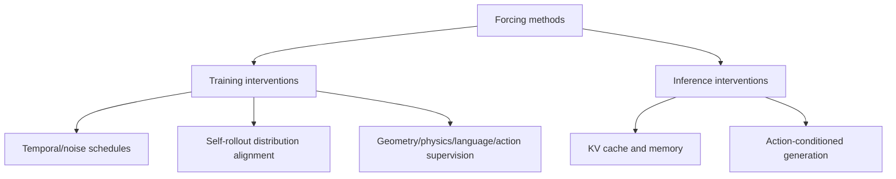

# Awesome Forcing for Embodied AI

A curated **mechanism-first** paper list of Forcing methods in embodied AI, robotic world/action models, and adjacent video generation.

**33 indexed entries · primary-source review in progress · execution verification pending.**

[Browse paper index](data/papers.csv) · [Code, checkpoints & evaluation](data/release-audit.csv) · [Contribute](CONTRIBUTING.md)

## Taxonomy

The term **Forcing** is used for different interventions, not a single unified technique.

## Selected papers

| Year | Work | Main mechanism | Paper | Code / project |
|---|---|---|---|---|
| 2024 | Diffusion Forcing | Temporal/noise | [Paper](https://arxiv.org/abs/2407.01392) | [Code](https://github.com/buoyancy99/diffusion-forcing) |
| 2025 | Self Forcing | Self-rollout alignment | [Paper](https://arxiv.org/abs/2506.08009) | [Code](https://github.com/guandeh17/Self-Forcing) |
| 2025 | Rolling Forcing | Rolling denoising | [Paper](https://arxiv.org/abs/2509.25161) | [Code](https://github.com/TencentARC/RollingForcing) |
| 2026 | PhysisForcing | Physical consistency | [Paper](https://arxiv.org/abs/2606.28128) | [Code](https://github.com/DAGroup-PKU/PhysisForcing) |
| 2026 | Fréchet Forcing | Rollout distribution | [Paper](https://arxiv.org/abs/2610.25666) | [Code](https://github.com/Zhao-Yian/Frechet_Forcing) |
| 2026 | Geometry Forcing | Geometry supervision | [Paper/index](data/papers.csv) | [Code](https://github.com/CIntellifusion/GeometryForcing) |
| 2026 | Next Forcing | Multi-chunk future prediction | [Paper](https://arxiv.org/abs/2606.11187) | [Code](https://github.com/robbyant-research/next-forcing) |
| 2026 | Causal Forcing | Causal autoregressive distillation | [Paper](https://arxiv.org/abs/2602.02214) | [Code](https://github.com/thu-ml/Causal-Forcing) |
| 2026 | Delta Forcing | Action conditioning | [Paper/index](data/papers.csv) | [Code](https://github.com/wyhallenwu/DeltaForcing) |
| 2026 | Forcing-KV | KV-cache optimization | [Paper](https://arxiv.org/abs/2605.09681) | [Code](https://github.com/zju-jiyicheng/Forcing-KV) |
| 2026 | Pyramid Forcing | Training-free KV optimization | [Paper](https://arxiv.org/abs/2605.13111) | [Code](https://github.com/IF-LAB-PKU/Pyramid-Forcing) |

**[Full 33-entry machine-readable paper list](data/papers.csv)** includes candidate entries that are not yet primary-verified. Papers are indexed for research navigation; individual release claims must be checked against the separate [availability audit](data/release-audit.csv).

## Release & reproducibility evidence

- [Code / weights / evaluation matrix](data/release-audit.csv)
- [Bibliography verification notes](docs/verification-2026-10-29.md)
- [Release audit](docs/release-audit-2026-10-29.md)
- [Expanded release audit](docs/release-audit-expansion-2026-10-29.md)
- [Follow-up checks](docs/remaining-17-release-verification-2026-10-29.md)

**Code listed ≠ runnable or independently reproduced.** All entries currently remain unexecuted in this project. Missing official releases are recorded as *not located*, not definitively *closed source*.

## Maintenance

- [Weekly arXiv discovery](.github/workflows/discover.yml): proposes candidate papers for human review.
- [Automated metadata validation](.github/workflows/validate.yml): checks CSV schema, duplicate names and paper IDs, and URL syntax.
- [Contribution guidelines](CONTRIBUTING.md): explain how to suggest or correct entries.

## Related lists

- [Awesome-Video-Forcing](https://github.com/Tammytcl/Awesome-Video-Forcing)
- [Awesome-World-Action-Models](https://github.com/RCL-Robotics/Awesome-World-Action-Models)
- [Awesome-Video-World-Models](https://github.com/hit-perfect/Awesome-Video-World-Models)

## License

[MIT](LICENSE) for original repository content. Third-party papers and code keep their own licenses.
