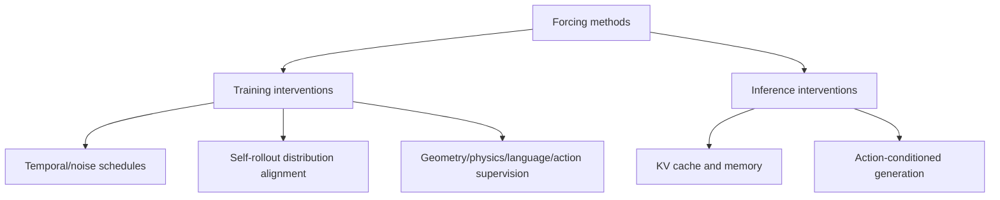

# Awesome Forcing for Embodied AI

A curated **mechanism-first** paper list of Forcing methods in embodied AI, robotic world/action models, and adjacent video generation.

**33 indexed entries · 33 primary-paper records reviewed · execution verification pending.**

[Browse paper index](data/papers.csv) · [Code, checkpoints & evaluation](data/release-audit.csv) · [Contribute](CONTRIBUTING.md)

## Contents

- [Start here: 8 essential papers](#start-here-8-essential-papers)
- [Embodied relevance](#embodied-relevance)
- [Taxonomy](#taxonomy)
- [Papers by embodied relevance](#papers-by-embodied-relevance)
- [Evidence and reproducibility](#release--reproducibility-evidence)
- [Maintenance and contributing](#maintenance)
- [Changelog](CHANGELOG.md)
- [Monthly research digest template](docs/monthly-digest-template.md)

## Start here: 8 essential papers

A suggested learning path, **not a ranking**. Start with general sequence training, then move toward geometry, physics, action fidelity and robot WAMs.

| Step | Paper | Why it matters |
|---:|---|---|
| 1 | [Diffusion Forcing](https://arxiv.org/abs/2407.01392) | Shows how different tokens can receive different noise levels in sequential diffusion. |
| 2 | [Self Forcing](https://arxiv.org/abs/2506.08009) | Addresses exposure bias by learning from model-generated histories. |
| 3 | [Rolling Forcing](https://arxiv.org/abs/2509.25161) | Introduces rolling-window denoising for long, streaming predictions. |
| 4 | [Geometry Forcing](https://arxiv.org/abs/2507.07982) | Injects geometric priors into video generation and representation learning. |
| 5 | [PhysisForcing](https://arxiv.org/abs/2606.28128) | Adds physical consistency objectives to embodied world modeling. |
| 6 | [WorldSync (Action-Forcing)](https://arxiv.org/abs/2608.24885) | Tests and improves whether a world model actually follows given actions. |
| 7 | [Next Forcing](https://arxiv.org/abs/2606.11187) | Uses multi-chunk future prediction in causal world/action modeling. |
| 8 | [Language-Forcing](https://arxiv.org/abs/2610.23894) | Adds semantic progress supervision to whole-body world/action models. |

**Legend:** Paper verified = bibliographic identity reviewed. **Implementation available** = an author-attributable public code implementation was found. **Project only** = landing page, placeholder or release announcement. **Unconfirmed** = no sufficient evidence. None of these implies a successful reproduction.

## Embodied relevance

| Scope | Count | Inclusion rule |
|---|---:|---|
| **Core embodied** | 9 | Robot control, manipulation/navigation or robot world/action models |
| **Transferable world models** | 14 | Video/world modeling mechanisms potentially useful in embodied learning |
| **Adjacent generation & systems** | 10 | Video inference, temporal memory or KV-cache optimizations without confirmed robot-policy evidence |

See [the paper-by-paper scope review](docs/embodied-scope-review.md) and the `embodied_relevance` field in [papers.csv](data/papers.csv). **Relevance classification is an editorial judgment, not a validated performance ranking.**

## Taxonomy

The term **Forcing** is used for different interventions, not a single unified technique.

## Papers by embodied relevance

The list is ordered by **embodied relevance**. Mechanisms are still shown within each tier; labels are editorial and not performance rankings.

<strong>Direct robot learning, manipulation, navigation, and WAM studies</strong> — 9 papers

Directly targets robotic control, manipulation, navigation, or robot WAMs.

#### Physics

| Year | Paper / method | Intervention | Paper | Code / project | Verification |
|---|---|---|---|---|---|
| 2026 | PhysisForcing | Physical and structural consistency | [Paper](https://arxiv.org/abs/2606.28128) | [Source](https://github.com/DAGroup-PKU/PhysisForcing) | reviewed |

#### Geometry & representation

| Year | Paper / method | Intervention | Paper | Code / project | Verification |
|---|---|---|---|---|---|
| 2026 | Relational Geometry Forcing | Pairwise geometry relations from frozen 3D foundation model | [Paper](https://arxiv.org/abs/2610.29282) | — | reviewed |

#### Action conditioning

| Year | Paper / method | Intervention | Paper | Code / project | Verification |
|---|---|---|---|---|---|
| 2026 | Action Forcing | Recover egomotion control axes from unlabeled videos | [Paper](https://arxiv.org/abs/2609.30595) | — | reviewed |
| 2026 | WorldSync (Action-Forcing) | Action-forcing expert and intervention-effect alignment | [Paper](https://arxiv.org/abs/2608.24885) | — | reviewed |

#### Action representation

| Year | Paper / method | Intervention | Paper | Code / project | Verification |
|---|---|---|---|---|---|
| 2026 | Discrete Forcing | Predict discrete action structure before continuous flow refinement | [Paper](https://arxiv.org/abs/2609.39526) | [Source](https://github.com/XPolicyLab/XPolicyLab/blob/main/policy/Discrete_Forcing/README.md) | reviewed |

#### Language

| Year | Paper / method | Intervention | Paper | Code / project | Verification |
|---|---|---|---|---|---|
| 2026 | Language-Forcing | Use frozen VLM semantic progress supervision for whole-body WAM | [Paper](https://arxiv.org/abs/2610.23894) | — | reviewed |

#### Future prediction

| Year | Paper / method | Intervention | Paper | Code / project | Verification |
|---|---|---|---|---|---|
| 2026 | Next Forcing | Multi-chunk future prediction | [Paper](https://arxiv.org/abs/2606.11187) | [Source](https://github.com/robbyant-research/next-forcing) | reviewed |

#### Rollout & exposure bias

| Year | Paper / method | Intervention | Paper | Code / project | Verification |
|---|---|---|---|---|---|
| 2026 | AR Forcing | Autoregressive training with model-generated navigation context | [Paper](https://arxiv.org/abs/2605.31314) | — | reviewed |
| 2026 | Step Forcing (RoboWorld) | Anchored and one-step self-forwarded robot rollout contexts | [Paper](https://arxiv.org/abs/2607.01060) | [Source](https://byeongguks.github.io/RoboWorld/) | reviewed |

<strong>General world/video modeling that may transfer to embodied learning</strong> — 14 papers

General video/world-model approaches potentially applicable to robot learning.

#### Temporal & diffusion noise

| Year | Paper / method | Intervention | Paper | Code / project | Verification |
|---|---|---|---|---|---|
| 2026 | Steady-Forcing | Dual spatial and motion memory for fixed-camera long rollouts | [Paper](https://arxiv.org/abs/2606.14732) | [Source](https://github.com/minar09/steady-forcing) | reviewed |
| 2025 | Rolling Forcing | Joint rolling-window denoising with progressive noise and attention sink | [Paper](https://arxiv.org/abs/2509.25161) | [Source](https://github.com/TencentARC/RollingForcing) | reviewed |
| 2024 | Diffusion Forcing | Per-token diffusion noise levels | [Paper](https://arxiv.org/abs/2407.01392) | [Source](https://boyuan.space/diffusion-forcing) | reviewed |

#### Rollout & exposure bias

| Year | Paper / method | Intervention | Paper | Code / project | Verification |
|---|---|---|---|---|---|
| 2026 | Causal Forcing | Autoregressive teacher for ODE initialization in causal distillation | [Paper](https://arxiv.org/abs/2602.02214) | [Source](https://github.com/thu-ml/Causal-Forcing) | reviewed |
| 2026 | Causal Forcing++ | Causal consistency distillation for 1-2 step frame-wise autoregression | [Paper](https://arxiv.org/abs/2605.15141) | [Source](https://github.com/thu-ml/Causal-Forcing) | reviewed |
| 2026 | Fréchet Forcing | Long rollout distribution matching | [Paper](https://arxiv.org/abs/2610.25666) | [Source](https://github.com/Zhao-Yian/Frechet_Forcing) | reviewed |
| 2026 | Self-Aligned Forcing | Differentiable denoising-stage-aligned noisy histories | [Paper](https://arxiv.org/abs/2609.38114) | — | reviewed |
| 2025 | Self Forcing | Self-generated autoregressive history reduces exposure bias | [Paper](https://arxiv.org/abs/2506.08009) | [Source](https://github.com/guandeh17/Self-Forcing) | reviewed |
| 2025 | Self-Forcing++ | Teacher-guided distillation on self-generated long-rollout segments | [Paper](https://arxiv.org/abs/2510.02283) | [Source](https://github.com/justincui03/Self-Forcing-Plus-Plus) | reviewed |

#### Geometry & representation

| Year | Paper / method | Intervention | Paper | Code / project | Verification |
|---|---|---|---|---|---|
| 2025 | Geometry Forcing | Align video diffusion intermediate features with pretrained 3D geometric features | [Paper](https://arxiv.org/abs/2507.07982) | [Source](https://github.com/CIntellifusion/GeometryForcing) | reviewed |

#### Memory

| Year | Paper / method | Intervention | Paper | Code / project | Verification |
|---|---|---|---|---|---|
| 2025 | Memory Forcing | Minecraft geometry-indexed spatial memory and chained forward training | [Paper](https://arxiv.org/abs/2510.03198) | [Source](https://junchao-cs.github.io/MemoryForcing-demo/) | reviewed |
| 2025 | Pack and Force Your Memory | MemoryPack global retrieval plus Direct Forcing to reduce exposure bias | [Paper](https://arxiv.org/abs/2510.01784) | [Source](https://wuxiaofei01.github.io/PFVG/) | reviewed |

#### Reward

| Year | Paper / method | Intervention | Paper | Code / project | Verification |
|---|---|---|---|---|---|
| 2025 | Reward Forcing | EMA-sink and reward-weighted distribution matching distillation | [Paper](https://arxiv.org/abs/2512.04678) | [Source](https://github.com/JaydenLyh/Reward-Forcing) | reviewed |

#### Action conditioning

| Year | Paper / method | Intervention | Paper | Code / project | Verification |
|---|---|---|---|---|---|
| 2026 | Delta Forcing | Trust-gated distribution matching to balance interactive reactivity and stability | [Paper](https://arxiv.org/abs/2605.14382) | [Source](https://github.com/wyhallenwu/DeltaForcing) | reviewed |

<strong>Video generation, streaming memory and inference-system optimization</strong> — 10 papers

Inference, memory, and generation systems; robotic task gains should not be inferred.

#### Inference & KV cache

| Year | Paper / method | Intervention | Paper | Code / project | Verification |
|---|---|---|---|---|---|
| 2026 | Deep Forcing | Training-free deep sink and participative KV compression | [Paper](https://proceedings.mlr.press/v306/yi26c.html) | [Source](https://github.com/cvlab-kaist/DeepForcing) | reviewed |
| 2026 | Focused Forcing | Content and head-aware per-frame KV selection | [Paper](https://arxiv.org/abs/2605.18346) | — | reviewed |
| 2026 | Forcing-KV | Hybrid head-specific static and dynamic KV pruning | [Paper](https://arxiv.org/abs/2605.09681) | [Source](https://github.com/zju-jiyicheng/Forcing-KV) | reviewed |
| 2026 | Future Forcing | Future-query-aware training-free KV cache selection | [Paper](https://arxiv.org/abs/2605.30083) | — | reviewed |
| 2026 | Head Forcing | Head-specific KV allocation and hierarchical memory | [Paper](https://arxiv.org/abs/2605.14487) | [Source](https://jiahaotian-sjtu.github.io/headforcing.github.io/) | reviewed |
| 2026 | Pyramid Forcing | Head-aware temporal KV policies | [Paper](https://arxiv.org/abs/2605.13111) | [Source](https://github.com/IF-LAB-PKU/Pyramid-Forcing) | reviewed |
| 2026 | Speculative Forcing | Early accept converged tokens, skip remaining denoising steps | [Paper](https://arxiv.org/abs/2610.22347) | [Source](https://github.com/naver-ai/speculative-forcing) | reviewed |

#### Memory

| Year | Paper / method | Intervention | Paper | Code / project | Verification |
|---|---|---|---|---|---|
| 2026 | Neighbor Forcing (SoulX-LiveAct) | Diffusion-step-consistent neighbor latents with ConvKV memory | [Paper](https://arxiv.org/abs/2603.11746) | [Source](https://github.com/Soul-AILab/SoulX-LiveAct) | reviewed |
| 2026 | RECAP-Forcing | Novelty-based appearance-indexed KV memory | [Paper](https://arxiv.org/abs/2608.26671) | [Source](https://github.com/xXuHaiyang/RECAP-Forcing) | reviewed |
| 2026 | Recency Forcing | Time-step dependent temporal response bias for KV eviction alignment | [Paper](https://arxiv.org/abs/2609.19729) | — | reviewed |

**Coverage:** 33 entries (9 core, 14 transferable, 10 adjacent). Source-level review is separate from code availability and reproducibility; see [release-audit.csv](data/release-audit.csv).

## Release & reproducibility evidence

- [Code / weights / evaluation matrix](data/release-audit.csv)
- [Bibliography verification notes](docs/verification-2026-10-29.md)
- [Release audit](docs/release-audit-2026-10-29.md)
- [Expanded release audit](docs/release-audit-expansion-2026-10-29.md)
- [Follow-up checks](docs/remaining-17-release-verification-2026-10-29.md)

**Code listed ≠ runnable or independently reproduced.** All entries currently remain unexecuted in this project. Missing official releases are recorded as *not located*, not definitively *closed source*.

## Automation status

The workflows write machine-readable status after each run (when repository write permissions allow):

- [Validation status](reports/validation-status.json)
- [Discovery status](reports/discovery-status.json)

A missing report means the workflow has not successfully written a report yet; it **does not** prove a run succeeded or failed. Status reports describe the workflow run, not independent paper reproduction. Pull-request validation cannot write to `main` by design.

## Maintenance

- [Changelog](CHANGELOG.md): dated repository changes and corrections.
- [Monthly digest template](docs/monthly-digest-template.md): structured, evidence-aware monthly research roundup (not automatically published).
- [Inclusion & editorial criteria](docs/INCLUSION_CRITERIA.md): strict paper, mechanism, relevance, and source requirements.

- [Weekly arXiv discovery](.github/workflows/discover.yml): proposes candidate papers for human review.
- [Automated metadata validation](.github/workflows/validate.yml): checks CSV schema, duplicate names and paper IDs, and URL syntax.
- [Contribution guidelines](CONTRIBUTING.md): explain how to suggest or correct entries.

## Related lists

- [Awesome-Video-Forcing](https://github.com/Tammytcl/Awesome-Video-Forcing)
- [Awesome-World-Action-Models](https://github.com/RCL-Robotics/Awesome-World-Action-Models)
- [Awesome-Video-World-Models](https://github.com/hit-perfect/Awesome-Video-World-Models)

## License

[MIT](LICENSE) for original repository content. Third-party papers and code keep their own licenses.
